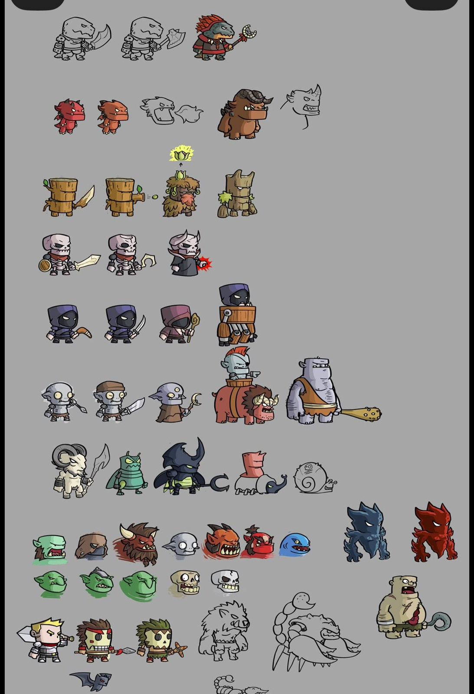
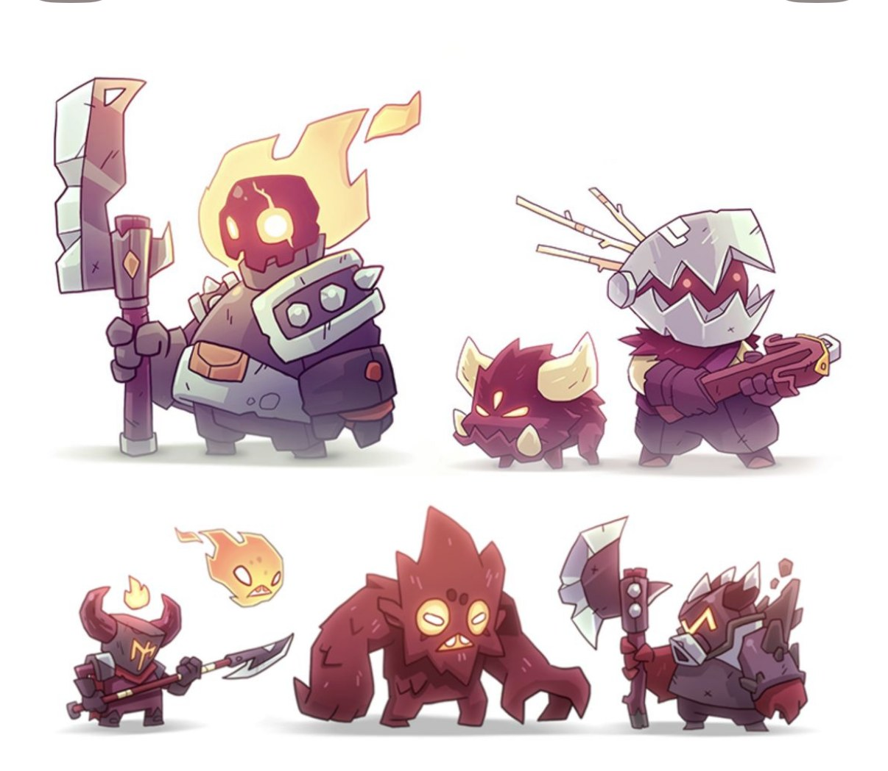
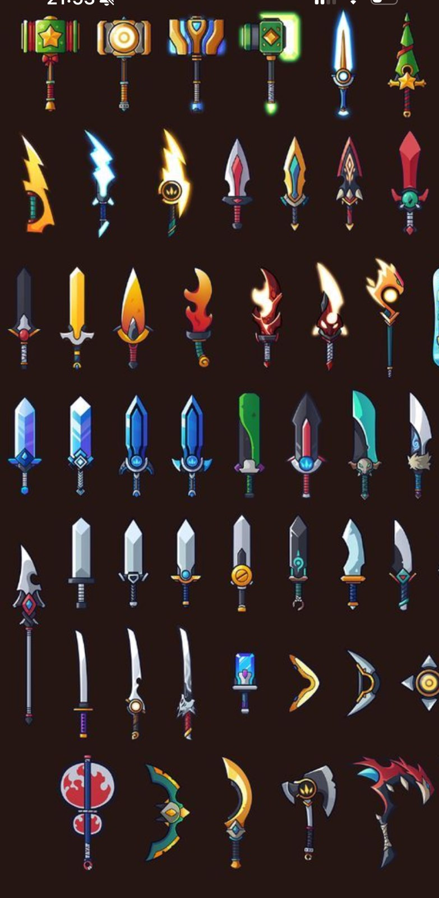
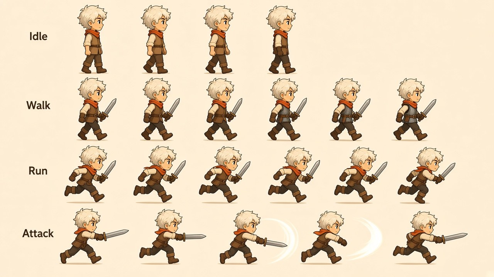

# Meadows — Art direction

The style target for Meadows. It feeds the style prompt and `planning/art-plan.md`.

> Images in `refs/` belong to their creators. They're for direction only: never shipped, traced or used as generation input. Only our own art in `hero/` and `concepts/` may be used as PixelLab references.

**Concept sheets:** every batch, and any new mob, item, NPC, area or gear, gets an approved sheet in `concepts/` before PixelLab runs. See the process in `planning/art-plan.md`.

## Style rules

From Oded: **clean, detailed pixel art, not chunky retro (think Sea of Stars or Eastward), with a cozy, nostalgic feeling; well animated, like PixelLab's animation demos.**

**The look is "hero 3"** in `tests/round-1/comparison.png`: subtle pixelation, made at 2× and scaled down to half. See the recipe below.

- **Chibi proportions:** big head, short limbs, readable face. The hero is about 4 heads tall; mobs can be chunkier.
- **Outlines:** keep the outline PixelLab's converter draws, and keep it consistent across assets. Don't add an extra or heavier outline pass.
- **Flat, bright colors with one soft shade** per material. No dithering, no noisy texture, no gradients.
- **Big, readable silhouettes** that read at game size against busy backgrounds.
- **Cute, chunky monsters:** round bodies, stubby legs, big eyes, even for the "angry" ones.
- **Fine detail, shown 1:1:** no nearest-neighbour upscaling and no visible big-pixel stair-steps. The game is drawn at 1920×1080 (see `planning/art-plan.md`).
- **Side view only.** Characters face east, and west is a mirror.
- **Environment:** clean, detailed layered parallax backgrounds made with the same recipe; a bright, readable foreground ground strip; soft light shafts in forests; a cozy, saturated palette per zone.
- **Animation is the selling point:** smooth idle breathing, a weighty run as the default movement (check frame timing, leg alternation, body bob and foot sliding), anticipation before attacks, squash on landing, and clear hit reactions.

## Recipe (every asset)

- **Size:** the hero is generated about 320 px tall (the largest converter source) and halved to about **160 px** on the 1920×1080 canvas. Every other asset uses the same scale.
- **Concept sheets** draw every asset at the same scale as the hero lineup.
- **Generate at 2× game size** with PixelLab's 1-generation converter in **faithful** mode, with no Pro Flash. **Remove the background and scale down to exactly half** locally with the finishing script in `tools/`. The engine never resizes art.
- **No added outline.** Animations at 2× cost about 3 generations each.

## References

### Characters & animation
| Reference | What we take from it |
| --- | --- |
|  Chibi hero sheet | Chibi proportions and the core set: idle, walk, run, jump. |

**Animation target:** the [PixelLab](https://www.pixellab.ai) demos. The concept-to-sprite hero is closest to Oded's style; the panda, golem and dragon set the motion bar (take the dragon's motion, not its pixels).

### Mobs
| Reference | What we take from it |
| --- | --- |
|  Cute monster collection | Mob cuteness, roundness and color variety; each family gets its own hue. |
|  Chibi enemy sheet (clean) | Stump/treant, goblin, bull and ram shapes for the Old Stump, the Angry Bull and Whisperwood. |
|  Orc / skeleton set with weapons | Chunky enemies; armor and weapons read at small size. |
|  Nature creatures | Whisperwood mob designs only. It’s more painterly and realistic than our target, so simplify to chibi. |
|  Fire chibi monsters | Later-zone enemies; glow accents on a flat-colored body. |
|  Boars, snakes and golems | The Boar and Angry Bull (tusks, bristles, charge pose), Dirt Banks stone golems, and snakes as future mob ideas. |

### Bosses & big creatures
| Reference | What we take from it |
| --- | --- |
|  Big chibi beasts (wolf, yeti, hydra) | Bosses that stay cute at a large scale: the Hollow Stag and the returning Old Stump. |
|  Chibi monsters (Booker) | Angry Bull and Boar energy; armored chibi bosses. |

### Icons & weapons
| Reference | What we take from it |
| --- | --- |
|  Weapon icon sheet | The item and weapon icon style target: clean, bright, one soft shade. |

### Backgrounds & environments
| Reference | What we take from it |
| --- | --- |
|  Green Hills / Deep Forest / Wheat Field / Hare Canyon | **The strongest background target.** Green Hills for Meadow West and East, Wheat Field for Sunny Pasture, Deep Forest for Whisperwood, Hare Canyon for the Dirt Banks. |
|  Vector forest, seamless | Whisperwood background; layered parallax that tiles. |
|  Stone and crystal platform tiles | Dirt Banks platforms and ore or crystal nodes: take the structure, render it in our cleaner style. |
|  Forest scene with a small hero | The overall in-game mood target: light, depth, foreground framing. |

### Mood & composition
| Reference | What we take from it |
| --- | --- |
|  Forest and farm gate with a well | Town-gate and farm composition, and the nostalgic mood. Pixelated, so don't copy the rendering. |

## Hero (locked)

The locked hero, an A+C mix, in the four armour looks: Cloth, Leather, Chain, Plate.
- Fluffy white hair, a short orange knotted scarf (no cape), and a simple fitted body. About 4 heads tall.
- Side view, facing right. Clean, detailed pixel art with the converter's own outline.
- Each look is a full animation set. Weapons are separate layers, pinned and rotated to a hand point and angle recorded on every frame, so they move with the hero. Hats use a head point the same way.
- Weapons are grouped by grip type (one-handed, two-handed, staff, bow). Each grip type has its own attack animations, and the other clips are shared. A new weapon is 1 sprite. See `planning/art-plan.md`.

Motion feel only: the bounce, the run lean and the slash arc. Don't copy its flaws: the idle has walking legs, the vest flips to chain mid-walk, and the attack is weak (no wind-up or follow-through).
