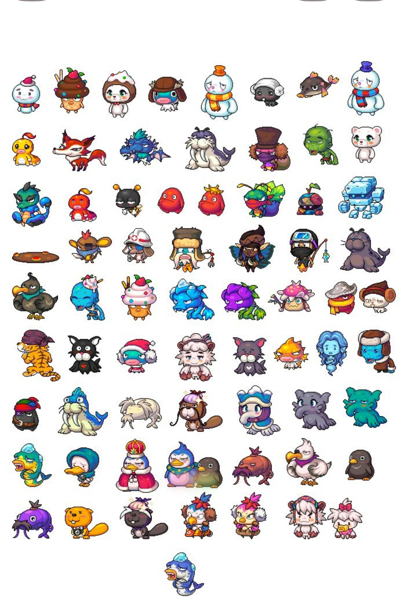
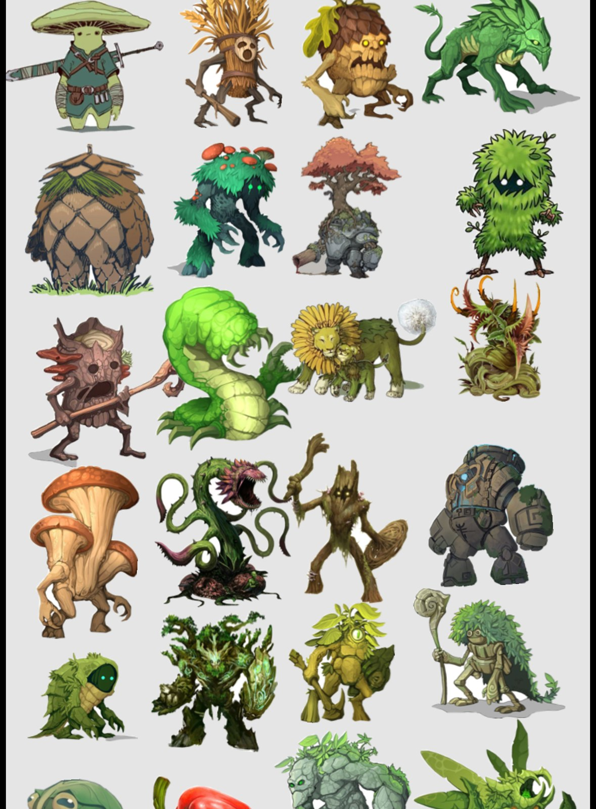
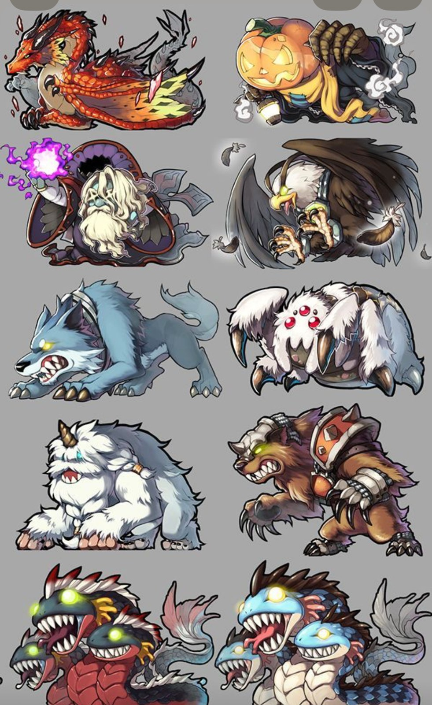
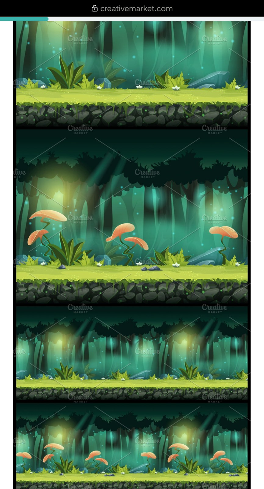
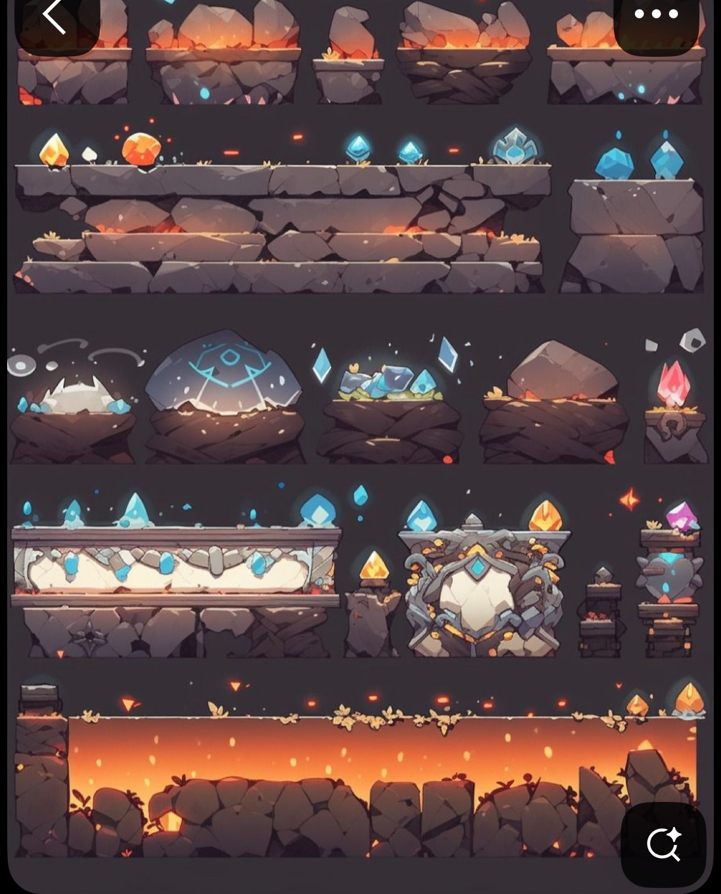
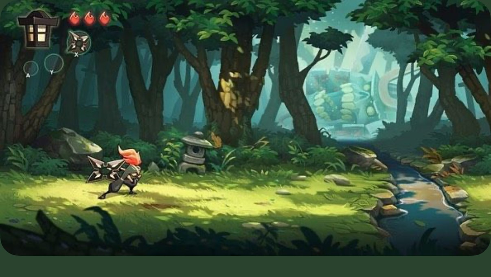
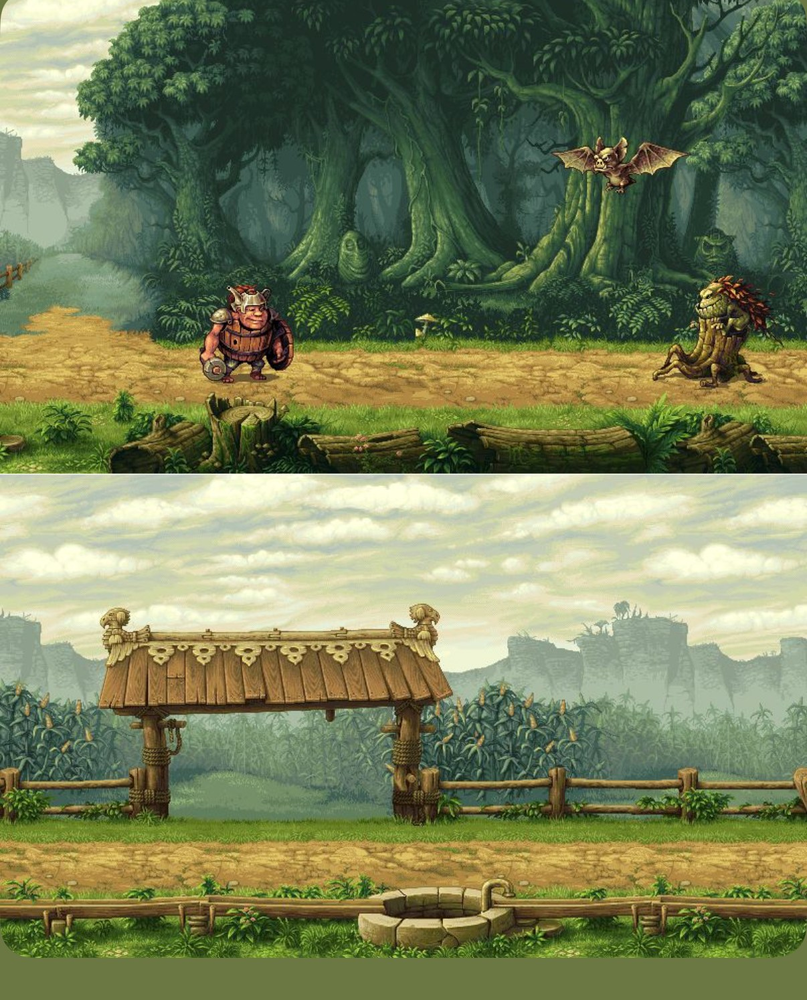
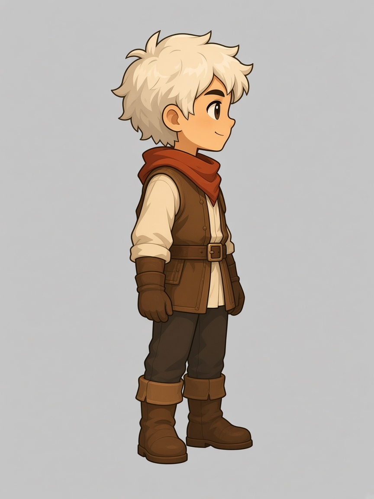
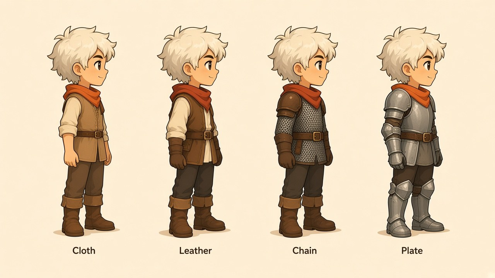

# Meadows — Art direction

The style target for Meadows. It feeds `planning/art-plan.md`.

> Images in `refs/` belong to their creators. They're for direction only: never shipped, traced or used as generation input. Only our own art (`rig-test/`, `hero/`, `concepts/`) is used as a style reference.

**Concept sheets:** every batch, and any new mob, item, NPC, area or gear, gets an approved sheet in `concepts/`, at the same scale as the hero, before production art is made.

## Style rules

**Smooth, hand-painted cartoon with a cozy storybook feel.** The benchmark is `rig-test/hero/base.jpg`.

- **Crisp, dark-brown outlines** and **soft cel shading**, with flat, warm colours and one soft shade per material.
- **Chibi proportions:** big head, short limbs, readable face. The hero is about 4 heads tall; mobs can be chunkier.
- **Big, readable silhouettes** that read at game size against busy backgrounds.
- **Cute, chunky monsters:** round bodies, stubby legs, big eyes, even for the "angry" ones.
- **Side view only.** Characters face east, and west is a mirror. The game is drawn at 1920×1080, with the hero about 160 px tall.
- **Environment:** painted parallax layers in the same style; a bright, readable foreground ground strip; soft light shafts in forests; a cozy, saturated palette per zone.

## How art is made

- **Static art is generated by Grok Bot for free:** hero parts, mobs, NPCs, icons, portraits, and backgrounds as parallax layers. The approved hero is the style reference for all of it.
- **Animation uses bone rigs, not frame-by-frame generation.** Claude rigs the parts in code and adds secondary motion (hair, scarf), squash and stretch, and code effects. A weighty run is the default movement, attacks have anticipation, and hit reactions are clear.
- **Gear swaps rig parts:** each armour look is a set of torso, arm and leg parts. Weapons and hats are pinned to the hand point (with angle) and the head point.

## References

### Characters & animation
| Reference | What we take from it |
| --- | --- |
|  Chibi hero sheet | Chibi proportions and the core set: idle, walk, run, jump. |

### Mobs
| Reference | What we take from it |
| --- | --- |
|  Cute monster collection | Mob cuteness, roundness and color variety; each family gets its own hue. |
|  Chibi enemy sheet (clean) | Stump/treant, goblin, bull and ram shapes for the Old Stump, the Angry Bull and Whisperwood. |
|  Orc / skeleton set with weapons | Chunky enemies; armor and weapons read at small size. |
|  Nature creatures | Whisperwood mob designs only. It’s more painterly and realistic than our target, so simplify to chibi. |
|  Fire chibi monsters | Later-zone enemies; glow accents on a flat-colored body. |
|  Boars, snakes and golems | The Boar and Angry Bull (tusks, bristles, charge pose), Dirt Banks stone golems, and snakes as future mob ideas. |

### Bosses & big creatures
| Reference | What we take from it |
| --- | --- |
|  Big chibi beasts (wolf, yeti, hydra) | Bosses that stay cute at a large scale: the Hollow Stag and the returning Old Stump. |
|  Chibi monsters (Booker) | Angry Bull and Boar energy; armored chibi bosses. |

### Icons & weapons
| Reference | What we take from it |
| --- | --- |
|  Weapon icon sheet | The item and weapon icon style target: clean, bright, one soft shade. |

### Backgrounds & environments
| Reference | What we take from it |
| --- | --- |
|  Green Hills / Deep Forest / Wheat Field / Hare Canyon | **The strongest background target.** Green Hills for Meadow West and East, Wheat Field for Sunny Pasture, Deep Forest for Whisperwood, Hare Canyon for the Dirt Banks. |
|  Vector forest, seamless | Whisperwood background; layered parallax that tiles. |
|  Stone and crystal platform tiles | Dirt Banks platforms and ore or crystal nodes: take the structure, render it in our cleaner style. |
|  Forest scene with a small hero | The overall in-game mood target: light, depth, foreground framing. |

### Mood & composition
| Reference | What we take from it |
| --- | --- |
|  Forest and farm gate with a well | Town-gate and farm composition, and the nostalgic mood. Pixelated, so don't copy the rendering. |

## Hero (locked)

The approved hero, in a rig-ready side view facing right: fluffy white hair, a short orange knotted scarf (no cape), and a simple fitted body, about 4 heads tall.

The armour looks (Cloth, Leather, Chain, Plate), each a set of rig parts. Use them for the costume design; `base.jpg` sets the rendering.

Motion feel only: the bounce, the run lean and the slash arc. Don't copy its flaws: the idle has walking legs, the vest flips to chain mid-walk, and the attack is weak (no wind-up or follow-through).
