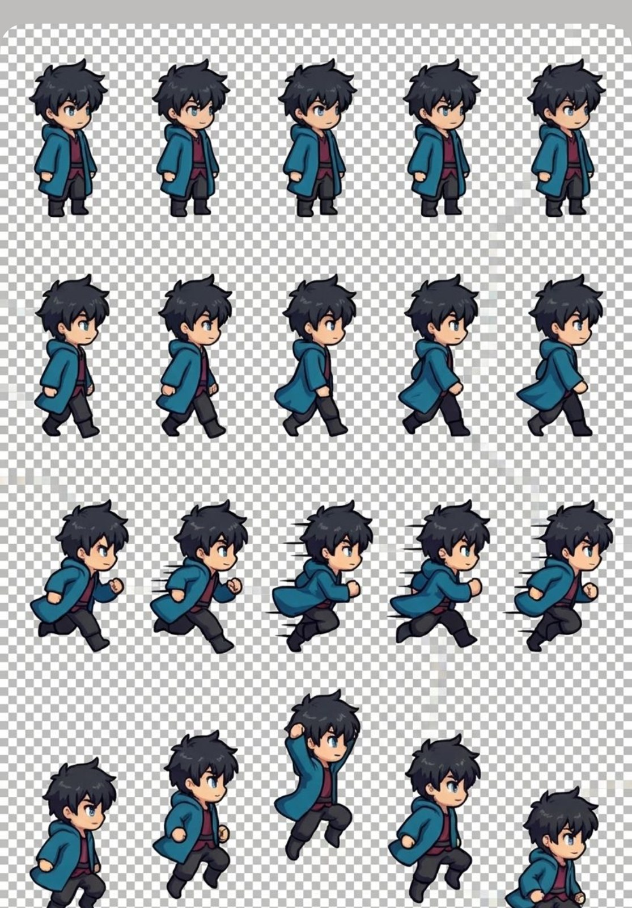
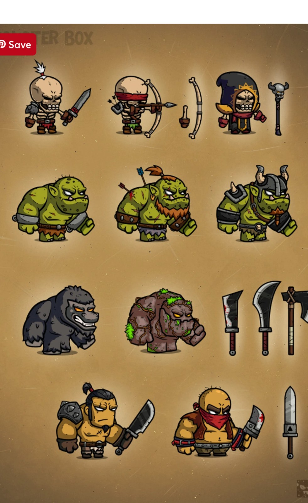
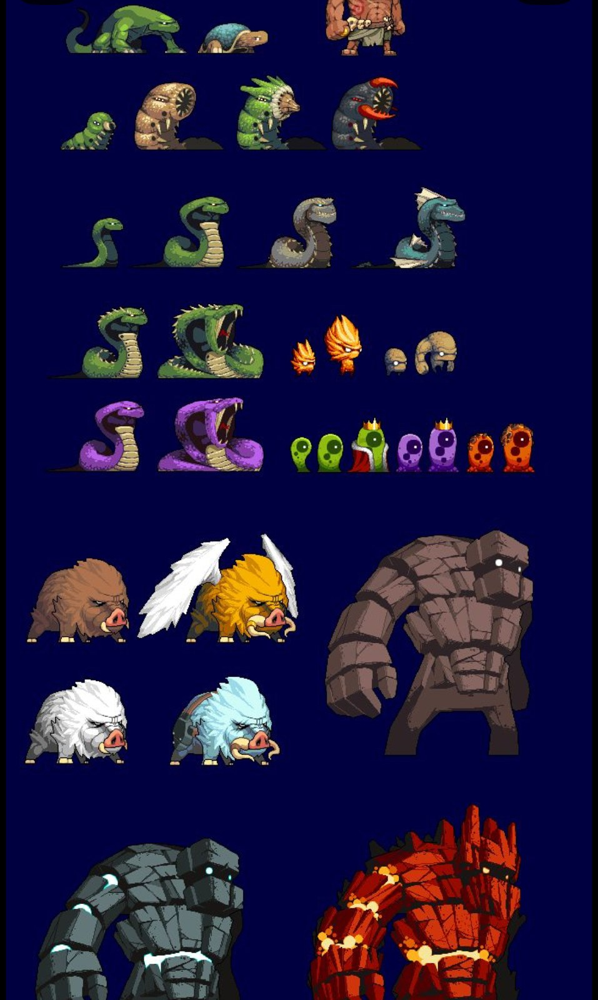
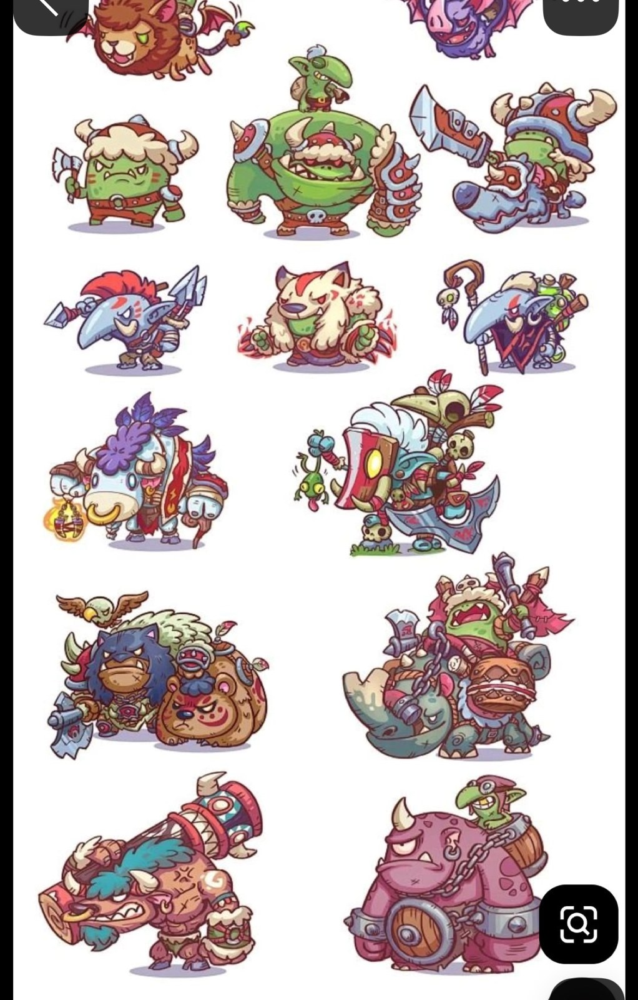
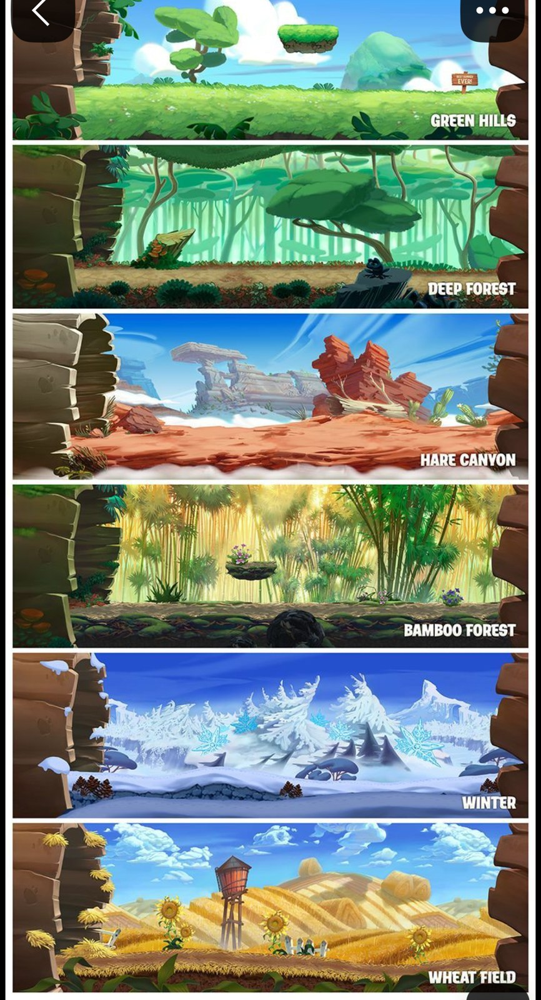
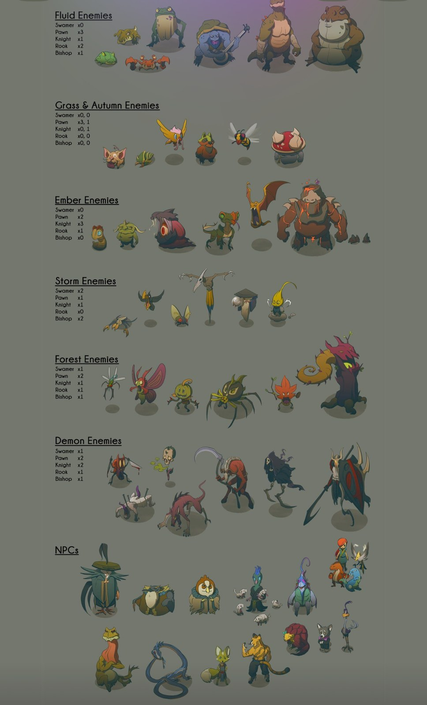
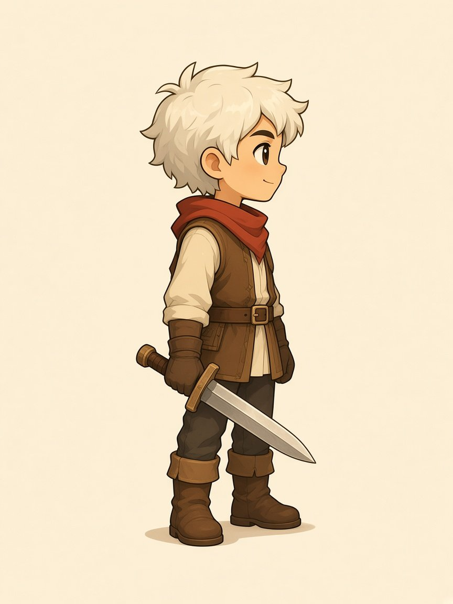
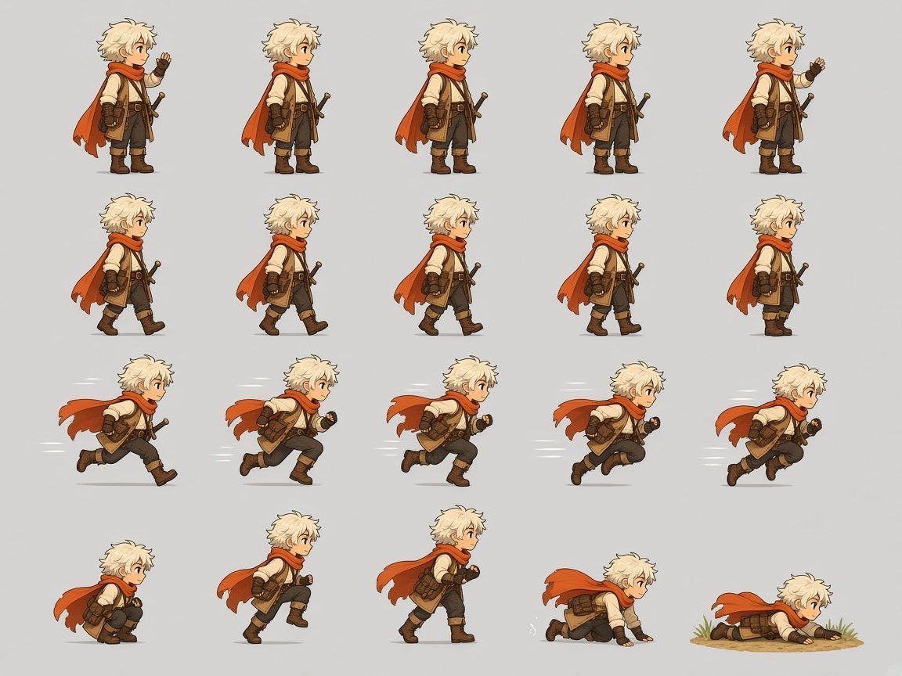

# Meadows — Art direction moodboard

The working portfolio for the Style Lock (see the studio's `STYLE-LOCK.md`). It collects the references Oded kept, our own hero candidates, and what we threw out and why. It feeds the style prompt and `planning/art-plan.md`.

> **Third-party references are for direction only.** Images in `refs/` belong to their creators (PixelLab demos, Creative Market packs, other artists). They are never shipped, traced or used as generation input. Only our own generated concepts (`hero/`) may be used as PixelLab references.

## Style rules

From Oded: **not heavily pixelated; smooth and sharp, with a cozy, nostalgic feeling; well animated, like PixelLab's animation demos.**

What the kept references share:
- **Chibi proportions:** about 2.5–3 heads tall. Big head, short limbs, readable face.
- **Bold, clean, dark outlines** around every character and mob. Not black everywhere: a dark tint of the local color.
- **Flat, bright colors with one soft shade** per material. No dithering, no noisy texture, no gradients.
- **Big, readable silhouettes** that read at game size against busy backgrounds.
- **Cute, chunky monsters:** round bodies, stubby legs, big eyes, even for the "angry" ones.
- **Fine detail, not chunky pixels:** sprites drawn at **64 px or more** and shown **1:1** in the 960×540 game. Edges are crisp, with no blur and no visible big-pixel stair-steps.
- **Side view only.** Characters face east, and west is a mirror.
- **Environment:** smooth, vector-like layered parallax backgrounds; a bright, readable foreground ground strip; soft light shafts in forests; a cozy, saturated palette per zone.
- **Animation is the selling point:** smooth idle breathing, a weighty walk and run, anticipation before attacks, squash on landing, and clear hit reactions.

## Kept references

Third-party images, for direction only (see the note at the top).

### Characters & animation
| Reference | What we take from it |
| --- | --- |
|  Chibi hero sheet | Proportions (about 2.5–3 heads) and the core set: idle, walk, run, jump. |

**PixelLab demos — linked, not stored.** The concept-to-sprite hero demo (Oded: **closest to his style**), plus the dragon, panda and golem animation demos, are on [pixellab.ai](https://www.pixellab.ai). They're the **animation quality target**: smooth follow-through, weight and bounce. The dragon is more pixelated than our target, so it counts for motion only.

### Mobs
| Reference | What we take from it |
| --- | --- |
|  Cute monster collection | Mob cuteness, roundness and color variety; each family gets its own hue. |
|  Chibi enemy sheet (clean) | Stump/treant, goblin, bull and ram shapes for the Old Stump, the Angry Bull and Whisperwood; bold outlines. |
|  Orc / skeleton set with weapons | Chunky enemies with bold outlines; armor and weapons read at small size. |
|  Nature creatures | Whisperwood mob designs only. It’s more painterly and realistic than our target, so simplify to chibi. |
|  Fire chibi monsters | Later-zone enemies; glow accents on a flat-colored body. |
|  Boars, snakes and golems | The Boar and Angry Bull (tusks, bristles, charge pose), Dirt Banks stone golems, and snakes as future mob ideas. |

### Bosses & big creatures
| Reference | What we take from it |
| --- | --- |
|  Big chibi beasts (wolf, yeti, hydra) | Bosses that stay cute at a large scale: the Hollow Stag and the returning Old Stump. |
|  Chibi monsters (Booker) | Angry Bull and Boar energy; armored chibi bosses. |

### Icons & weapons
| Reference | What we take from it |
| --- | --- |
|  Weapon icon sheet | The item and weapon icon style target: smooth, clean, bright, one soft shade. |

### Backgrounds & environments
| Reference | What we take from it |
| --- | --- |
|  Green Hills / Deep Forest / Wheat Field / Hare Canyon | **The strongest background target.** Green Hills for Meadow West and East, Wheat Field for Sunny Pasture, Deep Forest for Whisperwood, Hare Canyon for the Dirt Banks. |
|  Vector forest, seamless | Whisperwood background; smooth layered parallax that tiles. |
|  Stone and crystal platform tiles | Dirt Banks platforms and ore or crystal nodes: take the structure, render it smoother. |
|  Forest scene with a small hero | The overall in-game mood target: light, depth, foreground framing. |

### Mood, composition & organization only
_Don't copy the rendering: the first is pixelated, the second is flat and muted. Take only the idea in the right-hand column._

| Reference | What we take from it |
| --- | --- |
|  Metal-Slug-style forest and farm gate with a well | Town gate and farm composition, and the nostalgic mood. |
|  Enemy roster grouped by element | Only the organization idea: group each zone's enemies by family or element on one roster sheet. |

## Hero candidates

Our own generated concepts. **Oded liked A and C.**

### A — scarf and vest
 

What we take: the cleanest silhouette, with the red scarf as a readable accent. Vest, belt, gloves and boots map neatly onto our gear slots (torso, gloves, boots). Simple shapes are easy to animate.
Watch: in the mock the sword vanishes in the run and jump rows. Weapon handling has to be decided (held, sheathed or a separate sprite).

### C — cape and long coat
 

What we take: more adventure and warmth. The cape adds great follow-through in the run and jump, and the sheathed sword stays consistent across frames.
Watch: the cape and coat roughly double the animation work, and they cover the torso and legs slots. The last jump frames turn into a crawl on a dirt patch, so the jump needs redoing.

## Discarded

| Candidate | Why it's out |
| --- | --- |
| **B — farm kid** (our hero concept) | Not picked by Oded. The big hood hides the face and is hard to animate cleanly. |
| Dark gothic monsters | Too grim for a cozy game. |
| Chibi enemy sheet (cropped copy) | A duplicate of the clean chibi enemy sheet kept above. |
| Isometric pixel shops | Wrong perspective (isometric, not side view) and heavy pixels. **Idea kept:** shop signage icons hanging out front (Mara's shop, Ila's bench). |
| Pixel-art forest strips | Heavy pixel rendering. The layering idea is already covered by the vector forest and Green Hills. |

## Open questions

1. **A or C (or A with C's cape as a late-game cosmetic)?** A is cheaper to animate and to show gear on. C has more personality.
2. **Weapon on the hero:** held in hand in every frame, sheathed when not attacking, or a separate sprite attached in code (cheapest, and it fits the 12 weapons in the art plan)?
3. **Outline color:** pure dark brown everywhere, or a darker tint per color (warmer, as in A and C)?
