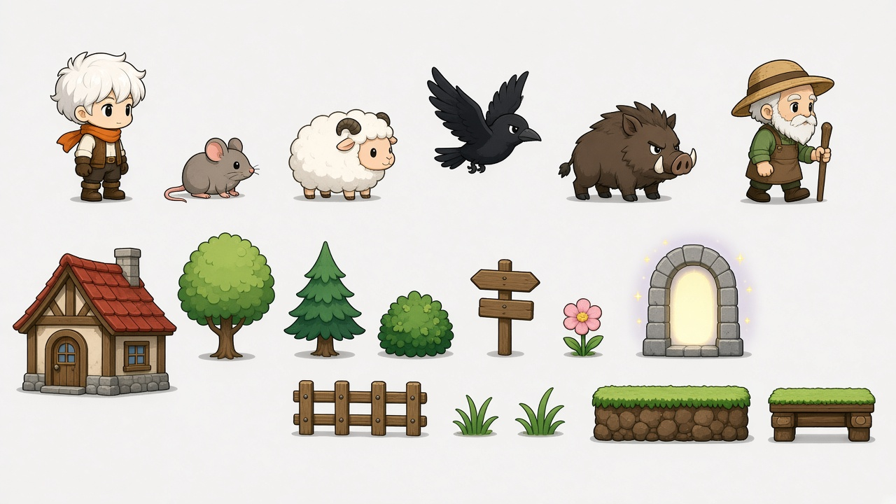

# Meadows: art direction

**Direction (locked 2026-11-16): basic chibi, like MapleStory.** Static sheets are generated by Grok Bot and brought to life in code with simple bone rigs. The full plan and asset index are in [planning/art-plan.md](../planning/art-plan.md).

## Style rules
- **Proportions:** humanoids are about **2.5 heads tall**, with a big head, small body and stubby limbs. Mobs are round and chunky.
- **Shapes:** simple round shapes with minimal detail. No texture, no fine rendering.
- **Lines:** bold, even **dark-brown or black outlines**.
- **Colour:** **flat colours with one shadow tone**. No gradients and no airbrushing. Each mob family gets its own hue. Variants such as named mobs and night forms are recolours with an accent.
- **View:** **side view facing right** for everything that moves. Items use a slight 3/4 view, and weapons are side-on at full length.
- **Sheets:** plain light grey background and **no text**.
- **Scale:** the hero is about **160 px** tall on the **1920×1080** canvas, and everything else is sized against him.

## The hero (locked)
| Sheet | Use |
| --- | --- |
| [`chibi/style/hero-poses.jpg`](chibi/style/hero-poses.jpg) | Keyframes for idle, walk, run (the default movement), jump/fall and climb |
| [`chibi/style/hero-swings.jpg`](chibi/style/hero-swings.jpg) | Keyframes for the 2-hit combo: a side slash, then an overhead smash |
| [`chibi/style/hero-rig-parts.jpg`](chibi/style/hero-rig-parts.jpg) | Rig parts: head, torso, upper and lower arms with gloves, legs with boots, and the wooden sword |

White hair, orange scarf, brown vest and gloves, dark trousers and brown boots. Armour icons stay in this palette family, and each tier is visibly distinct.

## Sheet formats
- **Mobs:** 4 rows. **Idle** (3) · **Walk/Fly** (4) · **Attack** (3: windup, strike with motion lines or a projectile, recover) · **Hit and die** (3: flinch, knockback, lying with swirly eyes).
- **NPCs:** full-body side view, idle plus a talk pose.
- **Items:** one sheet per batch, in a neat grid. Grid positions are mapped in [`chibi/items/index.md`](chibi/items/index.md).

## Folders
- `chibi/style/`: the concept sheet and the hero sheets (the style benchmark, always passed as a generation reference)
- `chibi/mobs/<mob>.jpg`, `chibi/npcs/<npc>.jpg`, `chibi/items/<batch>.jpg`
- `refs/`: third-party mood references (see below)

## Generating new art (Grok Bot)
Always pass `chibi/style/concept-sheet.jpg` plus the closest existing sheet as references: `mobs/boar.jpg` for beasts, `mobs/field-mouse.jpg` for small mobs, `npcs/pell.jpg` for people. A single creature reference makes the model copy that creature, so spell out the new anatomy, for example "a mole, NOT a boar". Reject and regenerate any result that has the wrong creature, missing legs or weapon, a front-facing pose, text, or a too-detailed or realistic drift.

## Third-party references (direction only)
Images in `refs/` belong to their creators. They are never shipped, traced or used as generation input.

| Reference | What we take from it |
| --- | --- |
| `refs/chibi-hero-sheet-idle-walk-run-jump.jpg` | Chibi proportions and the core movement set |
| `refs/cute-monster-collection.jpg`, `refs/chibi-enemy-sheet-treant-goblin-bull-ram.jpg`, `refs/boars-snakes-golems.jpg`, `refs/fire-chibi-monsters.jpg`, `refs/orc-skeleton-set-with-weapons.jpg` | Mob roundness, a hue per family, readable silhouettes |
| `refs/big-chibi-beasts-wolf-yeti-hydra.jpg`, `refs/chibi-monsters-armored-booker.jpg` | Bosses that stay cute at a large scale |
| `refs/weapon-icon-sheet.jpg` | Icon clarity: clean and bright, with one shade |
| `refs/backgrounds-green-hills-deep-forest-hare-canyon-wheat-field.jpg`, `refs/vector-forest-seamless-background.jpg`, `refs/stone-crystal-platform-tiles.jpg`, `refs/forest-scene-small-hero-mood.jpg` | Background and tile targets. Green Hills for the meadows, Wheat Field for Sunny Pasture, Hare Canyon for the Dirt Banks and Deep Forest for Whisperwood, all drawn flat in our style |
