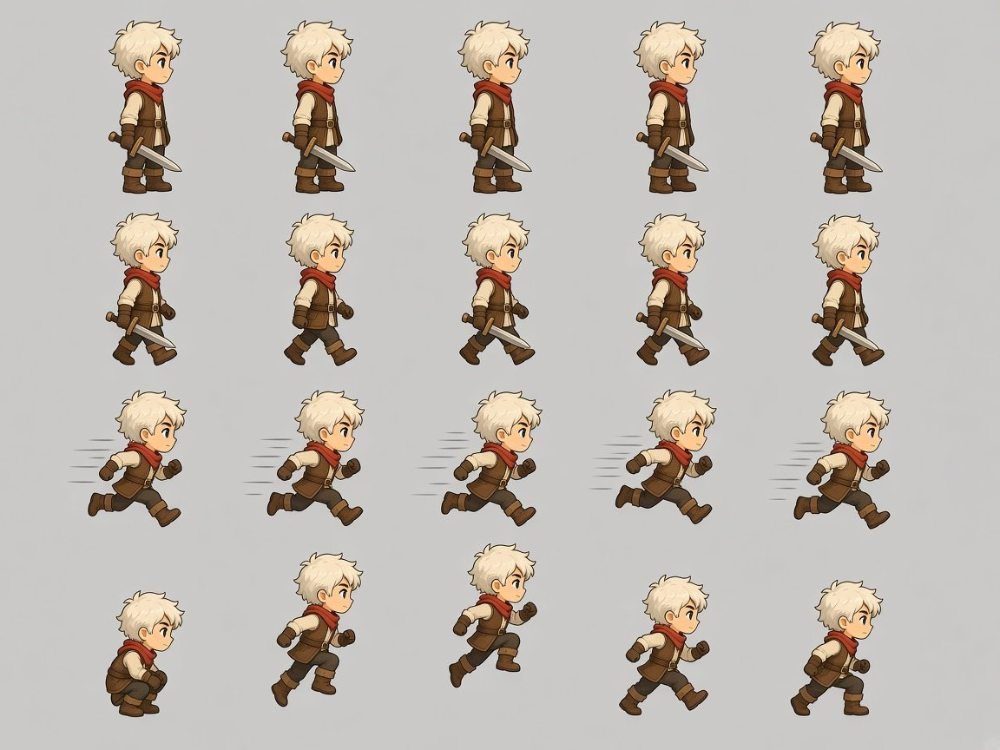
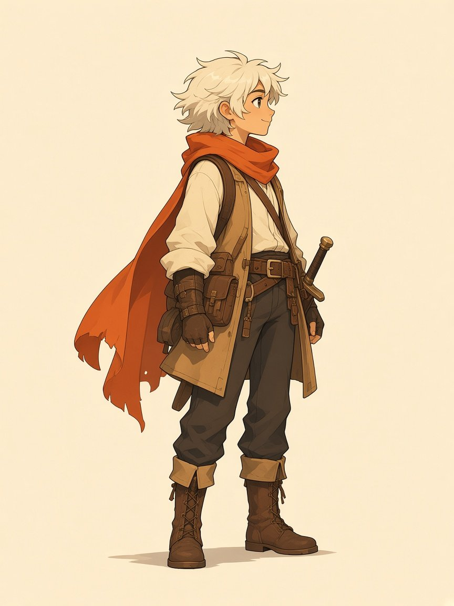

# Meadows — Art direction moodboard

The working portfolio for the Style Lock (see the studio's `STYLE-LOCK.md`). It collects the references Oded kept, our own hero candidates, and what we threw out and why. It feeds the style prompt and `planning/art-plan.md`.

> **Third-party references are for direction only.** Images in `refs/` belong to their creators (PixelLab demos, Creative Market packs, other artists). They are never shipped, traced or used as generation input. Only our own generated concepts (`hero/`) may be used as PixelLab references.

## Style rules

From Oded: **not heavily pixelated; smooth and sharp, with a cozy, nostalgic feeling; well animated, like PixelLab's animation demos.**

What the kept references share:
- **Chibi proportions:** about 2.5–3 heads tall. Big head, short limbs, readable face.
- **Bold, clean, dark outlines** around every character and mob. Not black everywhere: a dark tint of the local color.
- **Flat, bright colors with one soft shade** per material. No dithering, no noisy texture, no gradients.
- **Big, readable silhouettes** that read at game size against busy backgrounds.
- **Cute, chunky monsters:** round bodies, stubby legs, big eyes, even for the "angry" ones.
- **Fine detail, not chunky pixels:** sprites drawn at **64 px or more** and shown **1:1** in the 960×540 game. Edges are crisp, with no blur and no visible big-pixel stair-steps.
- **Side view only.** Characters face east, and west is a mirror.
- **Animation is the selling point:** smooth idle breathing, a weighty walk and run, anticipation before attacks, squash on landing, and clear hit reactions.

## Kept references

| Reference | What we take from it |
| --- | --- |
| `refs/pixellab-concept-to-sprite-hero-demo.png` — PixelLab concept-to-sprite hero demo | **Closest to Oded's style.** How a painted concept becomes a clean, smooth sprite without going chunky. Our target finish. |
| `refs/pixellab-dragon-animation-demo.png` — PixelLab dragon animation demo | Animation feel: wing follow-through, weight, looping idle. **More pixelated than our target**, so we keep it for motion only. |
| `refs/pixellab-panda-animation-demo.png` — PixelLab panda demo | Cute, round animal animated with bounce and squash. The bar for Sheep, Boar and Mouse. |
| `refs/pixellab-golem-animation-demo.png` — PixelLab golem demo | Heavy-creature motion: slow wind-up and impact. The bar for the Angry Bull, Hollow Stag and Moss Lurker. |
| `refs/chibi-hero-sheet-idle-walk-run-jump.png` — chibi hero sprite sheet | Proportions (about 2.5–3 heads) and the core animation set: idle, walk, run, jump. |
| `refs/cute-monster-collection.png` — cute monster collection | Mob cuteness, roundness and color variety. Every family gets its own hue. |
| `refs/creativemarket-orc-skeleton-set.png` — Creative Market orc / skeleton set | Chunky enemies with bold outlines, and how weapon icons read at small size. |
| `refs/chibi-enemy-sheet-treant-goblin-beast.png` — chibi enemy sheet | Stump / treant, goblin and bull / beast shapes. Ideas for Whisperwood mobs, the Old Stump and the Angry Bull. |

_The eight reference images above aren't in the repo yet; their file names are reserved. See open question 1._

## Hero candidates

Our own generated concepts. **Oded liked A and C.**

### A — scarf and vest
 

What we take: the cleanest silhouette, with the red scarf as a readable accent. Vest, belt, gloves and boots map neatly onto our gear slots (torso, gloves, boots). Simple shapes are easy to animate.
Watch: in the mock the sword vanishes in the run and jump rows. Weapon handling has to be decided (held, sheathed or a separate sprite).

### C — cape and long coat
 

What we take: more adventure and warmth. The cape adds great follow-through in the run and jump, and the sheathed sword stays consistent across frames.
Watch: the cape and coat roughly double the animation work, and they cover the torso and legs slots. The last jump frames turn into a crawl on a dirt patch, so the jump needs redoing.

## Discarded

| Candidate | Why it's out |
| --- | --- |
| **B — farm kid** (our concept) | Not picked by Oded. The big hood hides the face and is hard to animate cleanly. Not copied into the repo. |

## Open questions

1. **Reference images missing:** the eight kept references weren't on the build box when this was written, so their file names are reserved but empty. They need to be re-shared so they can be added (compressed, under 600 KB each).
2. **A or C (or A with C's cape as a late-game cosmetic)?** A is cheaper to animate and to show gear on. C has more personality.
3. **Weapon on the hero:** held in hand in every frame, sheathed when not attacking, or a separate sprite attached in code (cheapest, and it fits the 12 weapons in the art plan)?
4. **Outline color:** pure dark brown everywhere, or a darker tint per color (warmer, as in A and C)?
