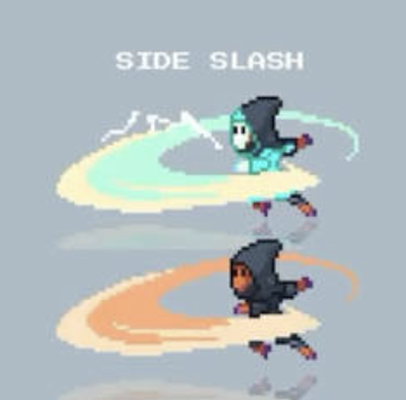

# Meadows v0.2.9 — Fixes before Whisperwood

A fixes-and-feel release on top of v0.2.8. No new area, no new skills. It reworks how a new Hero is welcomed and paced: a proper town intro, Paths that open only when earned, quests that appear gradually, slimmer rewards and drops, better quest writing, and a few UI and combat fixes. Design only; the developer has room to interpret.

**Still in force:** the Hero walks Paths (Warrior and Magician). Soul Guard, Spirit skills, the Meadow Shrine and infusion stay parked. Recipe rules from v0.2.6 stay (10–40 per material, family essence is the main cost). Marker rule from v0.2.6 stays: `!` a quest can be started, `?` a turn-in is ready.

---

## 1. Path trees open only when earned

- A Path’s tree is **hidden** until its Path quest is complete. Before Path of the Warrior is done, K shows no tree, just one short line: *“Calden in Meadow Town can set you on a Path.”*
- Finishing **Path of the Warrior** reveals the Warrior tab. Finishing **Path of the Magician** reveals the Magician tab. A tab you haven’t earned yet doesn’t appear at all, not even as “coming soon.”
- Inside a revealed tree, the v0.2.7 node states stay: locked, available, trained, with the next cost shown.

**Check:** a new Hero presses K and sees no tree. After Path of the Warrior, only the Warrior tab is there. The Magician tab only appears after Path of the Magician.

## 2. Every quest shows its marker and ends with the completion moment

- Pell’s current opener (“A First Step”) gives its reward without a marker or the quest-complete moment. The intro chain below replaces it. The rule itself is general: **every** quest, including every intro step, uses the same marker and completion flow.
- On every quest completion the player sees the **quest-complete animation and sound**, then the **rewards screen** (v0.2.6 layout). No quest completes silently or with only a toast.
- Intro steps that hand over a small gift also show the rewards screen.

**Check:** play from a fresh save through the whole intro chain and both Path quests. Each NPC shows `!` or `?` when they should. Every completion plays the animation and shows the rewards screen.

## 3. New start: the town intro, then the Path of the Warrior

### Welcome to Meadow Town (intro chain)

One quest with several steps. All of it happens **in town, before the first hunt**. Each NPC teaches one mechanic and gives a **very small** gift. The journal title stays the same throughout; the objective changes at each step.

| Step | NPC | Teaches | Gift |
| --- | --- | --- | --- |
| 1 | Pell (east gate) | Talking (E), the journal (J), objectives (L), `!` and `?` | 5 Copper |
| 2 | Mara | Shop and Copper: buy one Strawberry, and learn that junk sells | 2 Blueberry |
| 3 | Mara | Bag (I) and consumables: put a berry on Q and eat it | — |
| 4 | Mara’s storage chest | Storage: put one item in the chest and take it back | 1 Meadow Dew |
| 5 | Ila | Families (basic, Nature, Elemental), essence, the 10:1 bench, and that passives come later | 1 Clear Dew |
| 6 | Tamsin | Character sheet (C) and ability points: spend your first point | 2 Strawberry |
| 7 | Calden | Hand-off: the intro is done and the Path of the Warrior begins | — |

The whole chain gives **10 XP** (on the last step). No step gives materials.

### Path of the Warrior (Calden)

1. Talk to Calden.
2. Hit the training dummy (practice post) with **3 basic attacks**.
3. Help Calden clear the mice outside town: **defeat 5 Field Mice** and **bring 5 Twig**. The Twigs are consumed.
4. Return to Calden.
   - The **Warrior Path is revealed** and **Power Strike can be trained**. The player pays its normal recipe with what they gather. It is not granted for free.

### Path of the Magician (Tamsin)

- Becomes available **once Power Strike is trained** (rank 1). Tamsin shows her marker in town.
1. Talk to Tamsin.
2. Bring her **6 Wool** and **4 Feather** (for a focus charm). Consumed.
3. Return to Tamsin.
   - The **Magician Path is revealed**, and Magic Bolt can be trained with its normal recipe.

These two quests **replace** The Weight of a Swing, The Hero’s Paths and The Quiet Spell. Old saves that already finished those keep their skills and get both Path quests marked complete.

### Quests appear gradually

Each quest appears only once its condition is met. Until then it is invisible (see 9).

| Quest | Giver | Appears when |
| --- | --- | --- |
| Welcome to Meadow Town | Pell | New game |
| Path of the Warrior | Calden | Welcome to Meadow Town done |
| Path of the Magician | Tamsin | Power Strike trained |
| A Warm Coat | Mara | Level 3, after Path of the Warrior |
| The Dirt Path | Pell | Level 3, after Path of the Warrior (no passive-point prerequisite any more) |
| Blood Up | Calden | Level 4 |
| The Quiet Work | Ila | Level 4, after The Dirt Path (Pebble comes from the Banks) |
| What the Dirt Keeps | Pell | Level 5, after The Dirt Path |
| A Crack in the Dirt | Calden | Level 5 and The Dirt Path done, or picking up a Cracked Bank Stone after The Dirt Path |
| Hot Edge | Calden | Level 6 and A Crack in the Dirt done, or picking up a Smoldering Scale after that |

The existing STR gates on Crack and Hot Edge stay on their turn-in steps.

**Check:** a fresh Hero at level 1 sees only Welcome to Meadow Town. The Dirt Path never appears before level 3. Blood Up never appears before level 4.

## 4. NPCs never supply quest materials

Like a classic MMORPG: the NPC asks, the player gathers and brings. Remove every **kit** handed over mid-quest:

- Calden’s Power Strike rank-2 kit in The Hero’s Paths (that quest is gone).
- Tamsin’s Magic Bolt kit in The Quiet Spell (that quest is gone).
- Ila’s Nature passive kit in The Quiet Work. She now asks the player to gather the first rank’s cost and spend it themselves.

Gifts in the intro are limited to the few consumables and Copper listed in section 3. Final rewards come only at the end of a quest.

**Check:** no conversation adds materials to the bag. No NPC trains a skill or passive for the player.

## 5. Much smaller rewards

Cut XP and items to roughly a third or less. No essence piles, no stacks of consumables.

| Quest | Was | Now |
| --- | --- | --- |
| Welcome to Meadow Town | (A First Step: 15 XP, 5 Copper, 3 Meadow Dew) | 10 XP, plus the small step gifts above |
| Path of the Warrior | The Weight of a Swing 40 XP, 10 Copper, 8 Monster Essence + The Hero’s Paths 60 XP, 20 Copper, 6 Monster Essence, 4 Training Scroll | **25 XP, 5 Copper**, Warrior Path revealed |
| Path of the Magician | The Quiet Spell 70 XP, 20 Copper, 4 Clear Dew, 6 Monster Essence | **20 XP, 5 Copper, 1 Clear Dew**, Magician Path revealed |
| Blood Up | 60 XP, 15 Copper, 10 Monster Essence, Rage rank 1 | **20 XP, 5 Copper**, Rage rank 1 |
| The Dirt Path | 120 XP, 25 Copper, 8 Nature Essence, 5 Elemental Essence, 2 Meadow Dew | **35 XP, 8 Copper, 2 Nature Essence** |
| The Quiet Work | 80 XP, 15 Copper, 2 Meadow Dew (plus kit) | **25 XP, 5 Copper, 1 Meadow Dew** |
| A Warm Coat | 90 XP, 20 Copper, Hide Vest, 4 Blueberry | **30 XP, 6 Copper, Hide Vest** |
| What the Dirt Keeps | 140 XP, 30 Copper, Stone Club, 6 Nature Essence | **45 XP, 10 Copper, Stone Club** |
| A Crack in the Dirt | 100 XP, 20 Copper, 12 Nature Essence, Earthbreaker training | **35 XP, 7 Copper, 3 Nature Essence**, Earthbreaker training |
| Hot Edge | 140 XP, 25 Copper, 12 Elemental Essence, Flame Cleave training | **45 XP, 8 Copper, 3 Elemental Essence**, Flame Cleave training |

Gear gifts stay exact, mid and never magic (v0.2.6).

## 6. Quest copy: story-rich and professional

**Tone guide for every quest:**

- Each NPC has one recognizable voice. **Pell** is warm and folksy and knows every path. **Mara** is practical and dry and counts Copper. **Calden** is gruff and patient and believes in a real blow. **Ila** talks in growing things. **Tamsin** is dreamy and exact and counts under her breath.
- Short lines, one thought per page, two to five pages per conversation. No walls of text, no menu talk inside the fiction (“press K” goes in the objective line, not the dialogue).
- Every quest has a small **why**: a person, a problem, a bit of Meadows lore (the pasture’s mice, the Banks splitting open, the old warmth under the dirt).
- Titles are evocative and short (2–4 words). Journal text is one or two sentences in the third person, present tense, ending on what to do.
- The start, progress (“not yet”) and turn-in each get their own lines.

### Welcome to Meadow Town

Journal: *Meadow Town is small, but everyone in it knows something worth learning. Pell at the east gate is a good place to start.*

- **Pell (start):** “Ah — a new face at the gate. Welcome to Meadow Town.” / “Small place. Good people. Everyone here knows one thing worth knowing.” / “See the mark over a head? That one’s got something for you.” / “Here, five Copper. Mara at the counter will show you what it buys.”
- **Mara:** “Pell sent you? Then you’ve got five Copper and no idea what to do with it.” / “Strawberries are five. Buy one. That’s how a shop works.” / “And bring me your junk. Bones, pegs, shiny bits. I pay fair. I don’t buy what you need.” *(gift: 2 Blueberry)*
- **Mara (bag):** “A berry in the bag does nothing. Put one where your hand can find it and take a bite.” / “There. Feel better? Good. Now the chest.”
- **Mara (storage):** “That chest is mine, but you can use it. Your bag is not bottomless.” / “Put something in. Take it out. Now you know it’s safe.” / “Go see Ila. She deals in things that grow.” *(gift: 1 Meadow Dew)*
- **Ila:** “Everything out there carries a little of where it came from. Nature. Elemental. Basic, for the plain blows.” / “Kill enough, and that becomes essence. Essence is how a skill takes root.” / “Ten common things for one essence, at my bench. And one day, roots of your own that grow while you rest.” / “Tamsin is counting something by the well. She always is.” *(gift: 1 Clear Dew)*
- **Tamsin:** “Three. You have three. Points, I mean — you haven’t spent them.” / “Strength for the arm. Intellect for the spell. Agility for the feet. Spirit for the long breath.” / “Spend one. It changes you a little, and that’s the point.” / “Calden is waiting. He doesn’t like waiting.” *(gift: 2 Strawberry)*
- **Calden (hand-off):** “So. You’ve met the town. Now meet the work.”

### Path of the Warrior

Journal: *Calden wants to see what you’re made of before he puts a Path under your feet. Start at the practice post.*

- **Calden (start):** “Every Hero walks a Path. The Warrior’s is mine to teach.” / “It starts with a swing. Not a pretty one. An honest one.” / “Three blows on the post. Let me hear them.”
- **Calden (after the post):** “Better than I feared.” / “Now — the mice outside the gate are in the grain again. Clear five of them.” / “And bring me five Twig while you’re out. The post needs mending, and so do my manners.”
- **Calden (not yet):** “Five mice. Five Twig. I can count, Hero.”
- **Calden (turn-in):** “That’s a Warrior’s first day.” / “Here’s your Path. Power Strike is its first step — Monster Essence, a few scrolls, a little Copper, and it’s yours.” / “Walk it as far as you like.”

### Path of the Magician

Journal: *Tamsin has been watching you swing. She thinks your hands could hold something quieter. She needs wool and feathers for a focus charm.*

- **Tamsin (start):** “You hit things well. One, two, three — very loud.” / “There’s another Path. It asks more of your mana and less of your arm.” / “I need six Wool and four Feathers to make you a focus. Sheep and crows. Gently, if you can.”
- **Tamsin (not yet):** “Six and four. I’ve counted twice.”
- **Tamsin (turn-in):** “Soft wool, sharp feathers. A good focus.” / “Magic Bolt first. Watch your mana — it runs out before your courage does.” / “The Magician’s Path is open to you now.”

**Other quests:** keep each quest’s current steps and requirements (except the kit removals above). Rewrite their titles, journal text and every dialogue page to this tone guide. Title proposals: The Dirt Path → **Beyond the Pasture Gate**; Blood Up → **The Bargain of Rage**; The Quiet Work → **Roots That Grow**; A Warm Coat → **Wool Before Winter**; What the Dirt Keeps → **What the Banks Hide**; A Crack in the Dirt → **The Cracked Stone**; Hot Edge → **Ember in the Scale**.

## 7. Dialogue: Back as well as Continue

- Every multi-page conversation has **Back** (previous page) and **Continue** (next page). Back is hidden or disabled on the first page.
- Keys: Enter or click continues, Backspace or the left arrow goes back. Esc still closes without finishing.
- Going back never undoes or repeats a quest step. The step only advances on the last page, as today.

## 8. Magic scales with INT

- Magician Path skills (Magic Bolt, Fire Bolt, Thorn Volley, Chain Spark) gain damage from **INT** exactly the way Warrior Path skills and the basic attack gain it from **STR** (today: +1 attack for every 2 points).
- Warrior Path skills and the basic attack keep using STR. Mana Shield is unchanged.
- The formula stays hidden. The character sheet (C) shows **Attack** and a separate **Magic attack** so the player can see the effect of each stat.

**Check:** +2 INT raises Magic Bolt damage by the same amount +2 STR raises Power Strike. INT does nothing for Power Strike, and STR does nothing for Magic Bolt.

## 9. Journal shows only startable quests

- The journal lists **active** and **completed** quests, plus any quest that can be **started right now**.
- Locked quests and quests not yet discovered are **hidden** — no “soon” entries and no teasers. A quest appears the moment its condition in section 3 is met.

## 10. Basic attack: a gray side slash

- Replace the basic attack with a **wide horizontal crescent** swept in front of the Hero: a crisp gray-white edge, a softer gray body, and a short trailing tail that fades fast. See the reference below — same shape and energy, but **gray**, not cyan or orange.
- The arc reaches the real melee range. It stays snappy, with damage on the impact frame, plus the existing hit-stop, sparks and crit shake.
- Skill visuals (Power Strike, Earthbreaker, Flame Cleave and the Magician bolts) are unchanged.

## 11. Drop rates down, and no more than 3 of anything per kill

- Every drop chance is lowered by about **25%** (within the 20–30% band). For example, Field Mouse Twig goes from 40% to 30%, and Burrow Mole Monster Essence from 46% to about 35%. Gear and rare drops are lowered by the same proportion.
- Quantities stay as ranges, but **no single item ever drops more than 3 from one kill**, for every drop in the game, Copper included. Stacks above 3 are capped at 3. For example, Twig 2–5 becomes 2–3, and Monster Essence 2–5 becomes 2–3. Ranges already at 3 or below are unchanged.
- There is no limit on how many different items one kill can drop, and no forced quantity of 1.
- Guaranteed quest drops (Live Ember, a named foe’s quest item) stay guaranteed.

**Check:** across many kills, no item ever shows up in a stack bigger than 3 from a single kill, and common materials drop noticeably less often than in v0.2.8.

## 12. Buffs only in buff slots, attacks only in attack slots

- The 2 **buff slots** accept only buffs: Dig In, Rage and Mana Shield. The 4 **attack slots** accept only attack skills. Potion slots (Q and G) accept only consumables.
- Dropping a skill on the wrong kind of slot is refused with a short hint (“Buffs go in the buff slots”). Newly trained skills go into the first free slot of the right kind.
- Saves that already have a skill in the wrong slot are sorted into the right group on load.

**Check:** Rage, Dig In and Mana Shield can be placed in the buff slots, and nowhere else. Power Strike can’t be placed in a buff slot.

---

## Out of scope

No new area, skills, items or mobs. Recipes, HP, the XP curve (except quest XP), mob stats and Path chains are unchanged. Spirit skills and Soul Guard stay parked.

## Next

**Whisperwood** follows: the next area, for levels 5–10.
