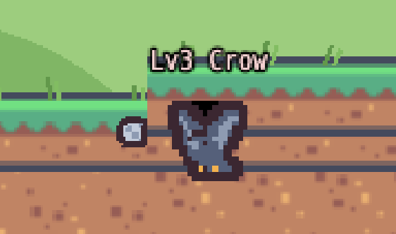

# Meadows v0.3.1 — Playtest fixes: west of town

A fixes release on top of v0.3.0, from Oded's latest playtest. The town gets a **west side**: Meadow West moves left of town and a new, slightly tougher **Sunny Pasture** lies beyond it. Meadow East loses its overpowered bull pack and the Old Stump, and gets a new level 5 **Boar** in their place. Also: Mara teaches healing with a slap, the skill tree opens itself after a Path quest, a farm list, a ready-to-train glow, clearer objectives, plain stat wording, a longer hit invulnerability, a crow spawn fix and a drop-range pass. This is design only, so the developer has room to interpret.

**Rules still in force:**
- Quests unlock by level or prerequisite. Players gather their own quest materials. Quest rewards stay low.
- Drop rates follow v0.2.9. **No item drops more than 3 per kill, except Copper.** Copper stays the only exception.
- Markers stay `!` and `?`. Every completion plays the banner, then the rewards screen.
- Whisperwood, its chain and the v0.3.0 rank recipes are unchanged.

**Reverses parts of v0.3.0** (each is marked ↩ below):
- Every map is no longer east of town; Meadow West moves to the west side and is flipped.
- The name "Sunny Pasture" comes back, now for a new map west of Meadow West.
- The Meadow Boar pack on the Meadow East terraces and the Old Stump in the raised grove are removed.
- New Heroes go west first; Pell stands at the west gate.

---

## 1. Maps: a west side for the town ↩

**New order, left to right:**

**Sunny Pasture → Meadow West → Meadow Town → Meadow East → Dirt Banks West → Dirt Banks East**

The Whisperwood stays north of Meadow East, up through the raised grove, exactly as in v0.3.0.

| Area | Levels | Change | Mobs (regular spawns) |
| --- | --- | --- | --- |
| **Sunny Pasture** (new, far west) | 3–5 | A wider, gently rolling meadow with one or two low ledges and no climbing. A dead end on its west side. Wildflowers, a broken fence, a lone big tree. | Wool Sheep 6, Crow 5, **Boar** 2 |
| **Meadow West** (moved west of town, flipped) ↩ | 1–3 | Same flat starter field, mirrored: the town gate is on its **east** edge now. | Field Mouse 8 nearest town, Wool Sheep 6 in the middle, **Crow 2** at the far-left end |
| **Meadow Town** | safe | Gains a **west gate**. Pell moves to it. The east gate stays. | — |
| **Meadow East** | 3–7 | Same hills. Sheep on the ground, Boars on the terraces, one Angry Bull in the raised grove. | Crow 4 and **Wool Sheep 4** on the ground, **Boar 4** on the terraces, **Angry Bull 1** in the grove. Wool-Shoulder stays on the far ground. |
| Dirt Banks West / East | 4–6 | Unchanged. | Unchanged |

**Flip rules for Meadow West:**
- Difficulty rises as you walk **away** from town: mice right by the gate, sheep further out, crows at the far-left end.
- The fence, low ledge and decor are mirrored too, so it reads as the same field, just on the other side.
- Sunny Pasture's portal is at Meadow West's far-left end.

**Check:** walk from Sunny Pasture's far end to Dirt Banks East. Every area has its listed mobs and no others. No Old Stump anywhere. Mice are the first thing a new Hero meets outside the west gate.

## 2. Angry Bull, the new Boar, and no Stump ↩

**Angry Bull** (renamed from Meadow Boar): same level 7, 225 HP, 47 XP, same drops (with the new ranges in section 7). It's a single, optional tough fight in the raised grove, where the Old Stump used to be. It looks angrier: a heavier body, a darker hide, a snort and a ground-paw before it charges.

**Old Stump:** doesn't spawn in this release. It returns later, deeper in a future Whisperwood map. No recipe needs Heartwood, so nothing is lost.

**Boar** (new): the Meadows' mid-level brute.

| Level | HP | Attack | Defense | XP | Behavior |
| --- | --- | --- | --- | --- | --- |
| 5 | 140 | 27 | 8 | 30 | Aggressive, melee. Short charge with a clear head-down wind-up; gives up when it can't reach you. |

**Look and feel:** a smaller, bristly brown boar with tusks, a trotting walk and a short dust puff on the charge. It flashes and squeals when hit and tips over on death. It must read clearly as a different animal from the Angry Bull.

**Boar drops** (existing items only):

| Drop | Chance | Stack |
| --- | --- | --- |
| Copper | 55% | 2–5 |
| Monster Essence | 27% | 1–3 |
| Fur | 25% | 1–3 |
| Leather Scrap | 20% | 1–2 |
| Nature Essence | 18% | 1–2 |
| Bark | 15% | 1–2 |
| Training Scroll | 12% | 1–2 |
| Old Bone (junk) | 8% | 1 |
| Blueberry | 6% | 1 |
| Leather Boots | 0.12% | 1 |

Leather Scrap matters: it's in the v0.3.0 rank 3–4 recipes, and with only one Angry Bull left, the Boar is now its main source.

## 3. West first: Pell, the welcome flow and place names ↩

New players go **west first**. Meadow West is the first hunt; Meadow East is the second stop.
- Pell stands by the **west gate**. The welcome chain still starts with him.
- Path of the Warrior sends the Hero out the west gate for the mice.
- Beyond the Pasture Gate is the "now try the other way" quest: east to Meadow East's crows, then on to the Banks.

**Copy changes** (every other line stays):
- **Welcome to Meadow Town** description: *"Meadow Town is small, but everyone in it knows something worth learning. Pell at the west gate is a good place to start."* Objective: *"Talk to Pell at the west gate."*
- **Path of the Warrior**, Calden: *"Now — the mice outside the west gate are in the grain again. Clear five of them."* Objective: *"Defeat mice and gather twigs outside the west gate."*
- **Beyond the Pasture Gate**, Pell: *"There you are. Level three already — the west meadow must be getting small."* · *"Try the other gate. East of town the grass climbs into hills, and past them the Banks begin. A river, then a cave."* · *"Crows keep the east meadow. Four of them. They steal more than seeds."* Objective step 1: *"Talk to Pell at the west gate."*
- **The Cracked Stone**, Calden: *"Go out the east gate and through the hills to the river."*
- **Mist on the North Road** and any other quest whose first step is *"Talk to Pell at the east gate"* now says *"west gate."*
- **Pell's chat lines:**
  - *"Meadow Town sits easy, for now. Out the west gate is honest work — mice and sheep leave you be unless you hit them. Crows at the far end, though."*
  - *"Past the west meadow is Sunny Pasture. Same grass, rougher company. A boar or two."*
  - *"Out the east gate it's all hills. Crows and sheep on the slopes, boars on the terraces, and a bull in the grove with a temper."*
  - *"Past that, the Banks: moles along the river, and a cave beyond it where the beetles keep a little warmth."*
  - *"Sell junk to Mara. Train with Calden. If you want something slower than a swing, Ila's bench is the place."*
- **Pell's NPC description:** *"Welcome to Meadow Town! Head out the west gate to Meadow West — mice and sheep leave you be unless you hit them. Later, the east gate leads to the hills and the Dirt Banks."*

**Check:** a fresh Hero follows the markers and never gets told to go east before Beyond the Pasture Gate. No text anywhere says "Pell at the east gate", "old stump" or "Meadow Boar".

## 4. Mara teaches healing with a slap

Mara's part of Welcome to Meadow Town changes so the player actually **sees** healing work.
1. Mara: buy a strawberry (unchanged).
2. After the purchase, Mara **slaps** the Hero for **18 HP**: a quick hand swipe, a red flash, a number, a little knockback. It can never kill (a new Hero has about 107 HP).
3. Mara: *"That's for walking in without wiping your boots."* · *"Now you're hurt. Put the berry where your hand can find it and take a bite. Watch the bar."*
4. The player eats the strawberry; the HP bar visibly fills back.
5. Mara: *"There. Feel better? Good. Go see Ila. She deals in things that grow."* Gift: 1 Meadow Dew (moved here from the chest step).

**The chest steps are removed** ("Put something in. Take it out."). The chest itself stays usable; it's just no longer a quest step. The rest of the chain is unchanged.

**Check:** the HP bar drops by 18 after the purchase and rises when the berry is eaten. The chain never mentions the chest.

## 5. Skill tree and objectives UI

**After a Path quest.** When Path of the Warrior or Path of the Magician completes, the rewards screen shows as usual. When it closes, the skill tree **opens on that Path's tab** with the first skill (Power Strike or Magic Bolt) **highlighted** with a soft pulse, and its rank 1 requirements highlighted too. The highlight ends on the first click or when the window closes. It happens only once per Path.

**Objective format.** Every quest objective is one general, readable line, with the counts listed underneath:
> Defeat mice and gather twigs outside the west gate.
> - Twig: 0/5
> - Field Mouse: 0/5

- Count lines use the item or mob name, `have/need`, one per line, and are checked off as they complete.
- Single-step objectives with nothing to count (talk to someone, walk somewhere) have just the line.
- This applies to the journal and the objectives panel.

**Farm list.**
- In the skill tree, the selected skill's rank recipe gets an **"Add to farm list"** button beside it.
- It adds a **farm objective** under the quests in the objectives panel, in **green**: *"Farm: Power Strike rank 3"*, with the recipe's materials as count lines (Leather Scrap 4/10, and so on).
- A second click on the same skill removes it, and so does a small ✕ on the objective. The entry goes away by itself once that rank is trained.
- Several skills can be on the list. Farm entries never show quest markers.

**Ready to train.** A skill node whose next rank is fully affordable (all materials, essence, scrolls and Copper in hand) **glows** gently in its family color, with a small up-arrow. Nodes that are trained to max or still locked never glow.

**Completed quests stand apart.**
- In the objectives panel, a quest that's ready to turn in shows its title in **bold gold** with a ✓.
- Its count lines show in a brighter green.
- Quests still in progress keep normal white text.

## 6. Plain stat wording

Stat descriptions (gear, passives, skills and stat points) describe **what** something raises, not by how much. Use one short, consistent pattern:
- *"Raises attack and max HP."*
- *"Raises max MP and magic damage."*
- *"Raises defense."*

**Rules:**
- No exact numbers in descriptions (no "+5 max MP").
- Exact numbers stay where they belong: the character screen, gear comparison and the next-rank preview.
- Use the same verbs and stat names everywhere: attack, magic damage, defense, max HP, max MP, crit, speed, HP regen, MP regen.

## 7. Combat fixes

**Hit invulnerability.** After taking damage the Hero is invulnerable for **1.0 s** (up from 0.7 s), with the same flicker. Touching an aggressive mob should never land two hits back to back.

**Crow spawn bug.** In Meadow East, Crows can spawn sunk into the dirt below the grass surface (see `planning/refs/crow-below-surface.png`). They seem to spawn at base ground height even where a hill rises.
- Every mob spawns standing on the actual surface where it appears, on top of a hill or ledge.
- Flying mobs hover above that surface.
- **Check:** reload Meadow East, Sunny Pasture and Meadow West many times. No mob ever appears inside the terrain.

## 8. Drop ranges

v0.2.9 capped stacks at 3 but kept the old minimum of 2, so many early drops became a flat 2–3. This pass fixes the ranges. Drop **chances** stay as they are, except where listed.

**Rules:**
- **Level 1–3 mobs** (Field Mouse, Wool Sheep, Crow): materials and essences that drop 2–3 now drop **1–2**.
- **Level 4+ mobs** (Burrow Mole, Earth Sprite, Ember Beetle, Spark Bug, Angry Bull, Hollow Stag, and the parked Frost Moth and Old Stump): drops at 2–3 now drop **1–3**.
- **Training Scroll:** level 1–3 mobs drop **1–2** at **at least 12%**, so Mouse and Sheep go from 9% to 12% and the Crow stays at 15%. Level 4+ mobs drop **1–3**, at their current rates.
- **Feather (Crow):** **40%, 1–3** (was 30%, 2–3).
- Drops already at 1–x, gear and junk stay as they are. Copper is unchanged.

**Examples:**
- Field Mouse: Twig 30% 1–2, Fur 27% 1–2, Bark 22.5% 1–2, Training Scroll 12% 1–2.
- Wool Sheep: Wool 30% 1–2, Fur 22.5% 1–2, Training Scroll 12% 1–2.
- Crow: Feather 40% 1–3, Twig and Bark 22.5% 1–2, Training Scroll 15% 1–2.
- Burrow Mole: Pebble 30% 1–3, Clay 27% 1–3, Training Scroll 12% 1–3.
- Hollow Stag: Moss Fiber 40% 1–3, Training Scroll 30% 1–3.

**Check:** no Mouse, Sheep or Crow drop shows a stack of 3 except Feather. No drop anywhere exceeds 3 except Copper.

---

## Out of scope (saved for later)

- The Old Stump's new home in a deeper Whisperwood map, and the Night Stump.
- New skills, new gear and recipe changes.
- Spirit skills, a Frost Shard replacement, and new Warrior skills.
- The Meadow Shrine, Dusk Margin and Frost Moth stay parked.

## Next

More Whisperwood maps, deeper and harder, where the Old Stump returns as a proper boss.
